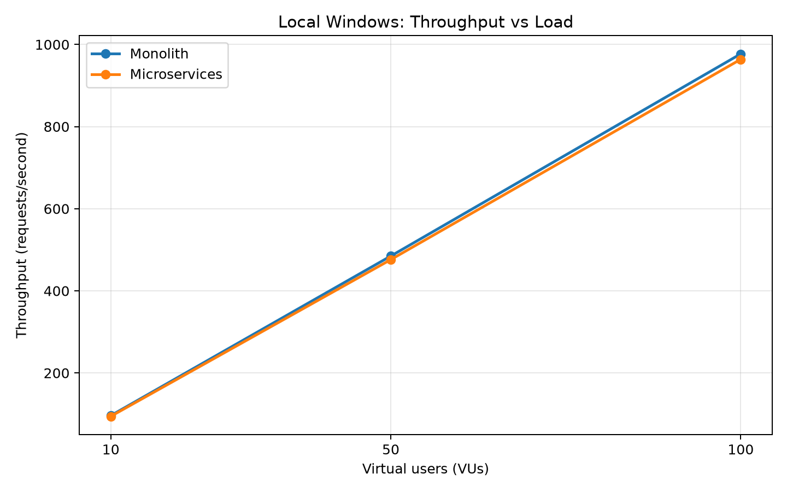
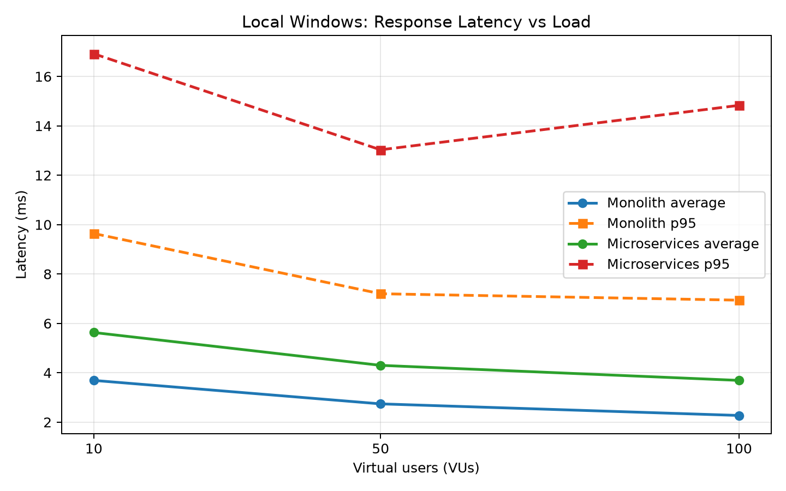
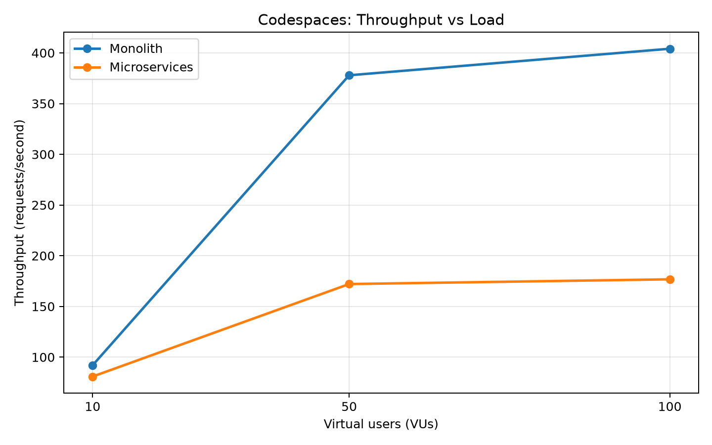
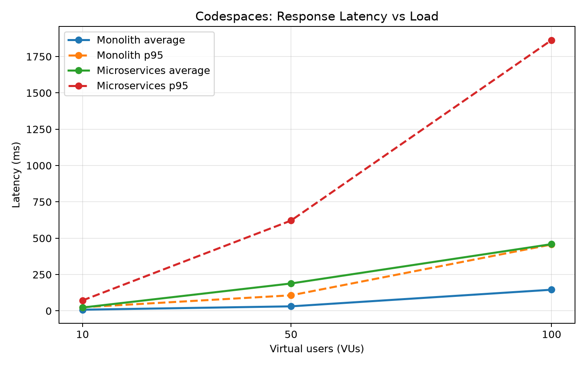
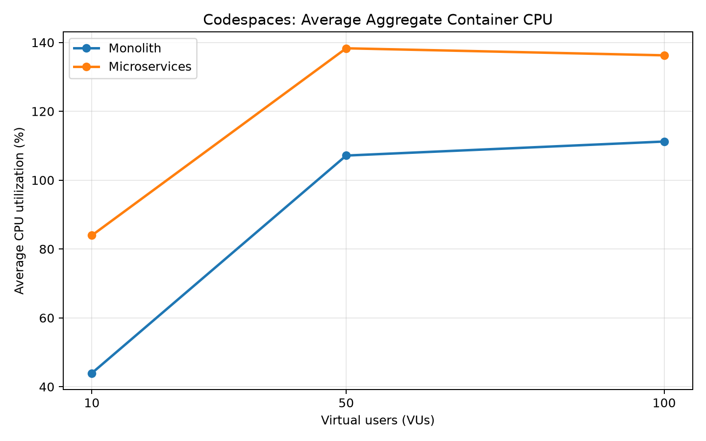
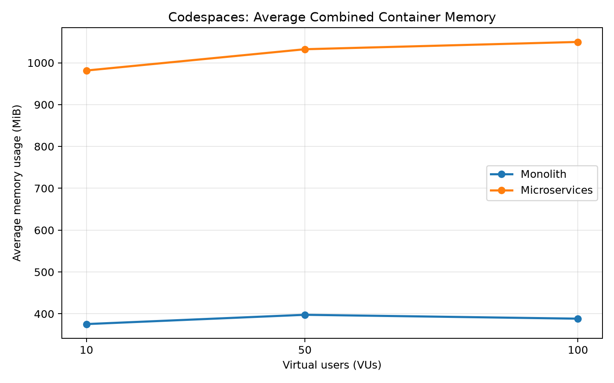

# Performance and Resource Utilization: Monolith vs Microservices

## 1. Abstract

This experiment compares an e-commerce monolithic application with a
microservices implementation under equivalent HTTP workloads. The comparison
measures request throughput, response latency, CPU utilization, and memory
consumption at 10, 50, and 100 virtual users (VUs).

Two environments were used: a local Windows machine and a cloud-hosted GitHub
Codespaces VM. Results from these environments are reported separately because
their hardware, operating systems, and resource-monitoring scopes differ.

In the Codespaces experiments, the monolith achieved higher external HTTP
throughput and lower response latency at all three load levels. The
microservices deployment consumed substantially more memory. Both deployments
completed all recorded requests successfully in the cloud experiments.
These findings apply to the specific implementations, workload, and test
environment used; they are not universal conclusions about either architecture.

## 2. Objectives

The experiment aims to:

1. Compare request throughput as the number of virtual users increases.
2. Measure average and tail response latency.
3. Observe CPU and memory utilization under load.
4. Examine how each implementation behaves as load increases.
5. Discuss the resource and performance trade-offs observed in this setup.

No actual cloud-provider billing measurement was performed. CPU and memory
utilization are used as resource-consumption indicators, not as measured
monetary cost.

## 3. Applications and Workload

The two implementations provide e-commerce operations involving products,
orders, and carts.

Each k6 virtual-user iteration performs the following five external HTTP
operations in order:

1. `GET` product list.
2. `GET` product details for product ID 1.
3. `POST` an order containing product ID 1 and quantity 1.
4. `POST` an item to the user's cart.
5. `GET` the user's cart.

After these operations, the virtual user sleeps for 0.5 seconds before
starting another iteration. The scripts use the virtual-user number as the
user/session identifier.

Both scripts use the same logical operation sequence, payload intent,
virtual-user levels, and test duration. The scripts check that each external
request returns HTTP status 200. The k6 request throughput therefore counts
requests made by the load script; it does not include internal
service-to-service HTTP requests made by the microservices application.

The microservices order service communicates synchronously with other services
over HTTP. These internal calls form part of the application workload, even
though they are not counted as external k6 requests.

### Test levels and repetitions

| Environment | Virtual users | Duration per trial | Repetitions per architecture |
|---|---:|---:|---:|
| Local Windows | 10 | 60 seconds | 2 |
| Local Windows | 50 | 60 seconds | 2 |
| Local Windows | 100 | 60 seconds | 3 |
| Codespaces VM | 10 | 60 seconds | 3 |
| Codespaces VM | 50 | 60 seconds | 3 |
| Codespaces VM | 100 | 60 seconds | 3 |

The Codespaces experiment contains 18 trials in total:
3 VU levels × 2 architectures × 3 repetitions.

Before each Codespaces trial, both Compose deployments are stopped and their
database volumes are removed. The selected architecture is then started, and
the readiness endpoints are checked before the load test begins. This provides
a fresh database volume for each trial.

## 4. Codespaces Environment and Measurement Method

The cloud-hosted experiments ran inside a GitHub Codespaces virtual machine.
This is a cloud-hosted development VM, not a production deployment on a
dedicated cloud application platform.

| Parameter | Configuration |
|---|---|
| Environment | GitHub Codespaces |
| Operating system | Ubuntu 24.04.5 |
| VM allocation | 2 vCPUs, approximately 7.8 GiB RAM |
| Container runtime | Docker Engine 29.9.2 |
| Docker Compose | 5.6.1 |
| Load-testing tool | k6 2.3.0 |
| Application runtime | Java 21 in application containers |
| Database | PostgreSQL 17 |
| Test duration | 60 seconds per trial |
| VU levels | 10, 50, 100 |

The monolith runs as one application container with a PostgreSQL container.
The microservices deployment runs catalog, cart, and order application
containers with a PostgreSQL container hosting three logical databases.
The microservices databases therefore share the same PostgreSQL server in
this experiment; they are not separate database servers.

The k6 process runs on the Codespaces host, outside the application
containers. Docker resource monitoring records the application and database
containers while k6 is running. Consequently, the reported container resource
measurements exclude the k6 process and the rest of the host operating system.

CPU percentages are Docker-reported container CPU usage relative to one CPU
core and can exceed 100% when a container or group of containers uses more
than one core. Aggregate CPU values represent the sum of the monitored
containers' CPU percentages. Memory values represent the combined memory
usage of the monitored application and database containers.

Resource monitoring was performed using repeated `docker stats --no-stream`
samples during each test. The sampling loop sleeps for approximately one
second, but the actual interval can vary; the measurements should not be
interpreted as perfectly fixed one-second samples.

## 5. Codespaces Performance Results

The following values are arithmetic means of the three trial-level summary
values for each architecture and VU level. They are not pooled
per-request statistics.

| VUs | Architecture | Throughput (req/s) | Average latency (ms) | p95 latency (ms) |
|---:|---|---:|---:|---:|
| 10 | Monolith | 91.95 | 8.15 | 25.05 |
| 10 | Microservices | 80.86 | 22.87 | 71.80 |
| 50 | Monolith | 377.92 | 31.21 | 107.00 |
| 50 | Microservices | 172.08 | 188.56 | 621.21 |
| 100 | Monolith | 404.10 | 145.54 | 456.77 |
| 100 | Microservices | 176.73 | 459.27 | 1863.33 |

### Interpretation

At 10 VUs, the monolith achieved approximately 1.14 times the throughput of
the microservices implementation. At 50 and 100 VUs, the monolith achieved
approximately 2.20 and 2.29 times the microservices throughput, respectively.

The latency gap also increased under heavier load. At 100 VUs, the
microservices average latency was approximately 459 ms, compared with
approximately 146 ms for the monolith. The microservices p95 latency was
approximately 1,863 ms, compared with approximately 457 ms for the monolith.

The monolith's throughput increased from 10 to 50 VUs, then increased more
modestly from 50 to 100 VUs. The microservices throughput increased from 10
to 50 VUs but changed comparatively little from 50 to 100 VUs. This suggests
that the microservices implementation reached a throughput plateau within
the tested range, while its response latency continued to rise.

These results show how the two tested implementations behaved on this VM.
They do not establish a universal performance limit for microservices.

## 6. Codespaces CPU and Memory Results

The following table reports the mean resource measurements across three
trials. CPU is the average aggregate CPU percentage across the monitored
containers. RAM is the average combined memory usage of those containers.

| VUs | Architecture | Average CPU (%) | Peak CPU (%) | Average RAM (MiB) | Peak RAM (MiB) |
|---:|---|---:|---:|---:|---:|
| 10 | Monolith | 43.94 | 107.63 | 375.51 | 396.28 |
| 10 | Microservices | 83.94 | 195.93 | 981.51 | 1007.20 |
| 50 | Monolith | 107.14 | 141.26 | 397.71 | 416.26 |
| 50 | Microservices | 138.30 | 193.62 | 1032.38 | 1074.03 |
| 100 | Monolith | 111.22 | 138.15 | 388.43 | 420.18 |
| 100 | Microservices | 136.26 | 172.29 | 1049.81 | 1099.01 |

### Interpretation

The microservices deployment used more memory at every tested load level.
Its average combined container memory consumption was approximately 2.6
times that of the monolith at 10 VUs, 2.6 times at 50 VUs, and 2.7 times at
100 VUs.

The microservices deployment also recorded higher average aggregate CPU
utilization at all three load levels. The difference was largest at 10 VUs.
At 50 and 100 VUs, both deployments used substantial CPU resources, with
the microservices deployment still recording the higher average.

The memory difference is consistent with the microservices deployment
running multiple application services, each with its own JVM and runtime
overhead. Synchronous inter-service communication can also contribute to
processing overhead and latency. These are plausible explanations, not
isolated causal findings from this experiment.

The CPU values above 100% do not mean the measurements are invalid: Docker's
CPU percentage is relative to one core, and the VM has two vCPUs. Peak CPU
values are trial-level peaks averaged across the three repetitions.

## 7. Local Windows Performance Results

The local Windows benchmarks are presented separately from the Codespaces
experiments. They used the same five-operation workload and 60-second
duration, but ran on a different host and used a different resource
measurement setup.

The table reports arithmetic means of the trial-level summaries. The
10-VU and 50-VU results contain two trials per architecture; the 100-VU
results contain three trials per architecture.

| VUs | Architecture | Throughput (req/s) | Average latency (ms) | Median latency (ms) | p95 latency (ms) |
|---:|---|---:|---:|---:|---:|
| 10 | Monolith | 96.13 | 3.69 | 2.53 | 9.64 |
| 10 | Microservices | 94.41 | 5.63 | 2.73 | 16.92 |
| 50 | Monolith | 484.73 | 2.74 | 1.92 | 7.20 |
| 50 | Microservices | 476.04 | 4.30 | 2.09 | 13.03 |
| 100 | Monolith | 977.14 | 2.27 | 1.42 | 6.94 |
| 100 | Microservices | 963.89 | 3.69 | 1.40 | 14.83 |

### Interpretation

In the local Windows tests, the monolith recorded slightly higher throughput
at all three load levels. It also recorded lower average and p95 latency.
The throughput difference was relatively small compared with the difference
observed in the Codespaces experiments.

The local measurements should not be combined with the Codespaces values or
used to claim a direct improvement between environments. The two environments
have different hardware and execution conditions.

Local Windows resource-monitoring captures are not included in the resource
comparison. Their timestamps do not reliably match the corresponding k6
trials, and their measurement scope differs from Docker monitoring: the
Windows monitor measured Java application processes, excluding PostgreSQL
and k6. Using those unmatched captures as if they were paired with the
performance trials would risk drawing unsupported conclusions.

## 8. Reliability and Functional-Equivalence Checks

All 18 Codespaces trials completed with zero failed external HTTP requests
and successful HTTP 200 checks for the five operations in the k6 workload.
The local trials also recorded zero failed HTTP requests and successful
status checks.

However, successful HTTP status checks do not prove that both applications
produce semantically identical responses or business outcomes.

One known difference is the cart response/model. The monolith cart response
contains product and user information, whereas the microservices cart model
uses a session identifier and permits a nullable price. The k6 checks verify
HTTP status codes rather than comparing response bodies, cart totals, or
persisted business state.

The benchmark therefore provides a comparison of the tested HTTP workflows,
not a complete proof of functional equivalence.

## 9. Limitations

1. **Limited repetitions:** The cloud tests use three repetitions per
   configuration. The local 10-VU and 50-VU tests use two repetitions, and
   local 100-VU tests use three. These sample sizes are small; standard
   deviations are descriptive and no statistical-significance claim is made.

2. **Environment specificity:** Codespaces is a shared cloud-hosted
   development environment. Results may differ on dedicated VMs, production
   cloud instances, or other hardware.

3. **Different local and cloud environments:** Local Windows and Codespaces
   results are reported separately and must not be pooled or compared as
   though only the architecture changed.

4. **Imperfect semantic equivalence:** The k6 scripts use the same logical
   operations and payload intent, but the cart data models and responses
   differ. The checks validate HTTP 200 responses rather than business-level
   equality.

5. **Database topology:** The microservices use three logical databases
   hosted by one PostgreSQL server. This does not represent every possible
   database-per-service deployment.

6. **Resource scope:** Codespaces Docker resource measurements combine
   application and database containers but exclude the k6 process and host
   operating system. They are not measurements of the entire VM's resource
   consumption.

7. **Sampling granularity:** Docker stats samples are collected in a loop
   with an approximately one-second sleep. The sampling interval is not
   guaranteed to be exact.

8. **No monetary cost measurement:** No cloud billing data, instance pricing,
   or cost-per-request calculation was collected. Resource usage can inform
   a discussion of potential infrastructure cost, but it is not a direct
   measurement of cost.

9. **Implementation-specific overhead:** The microservices application uses
   multiple JVMs and synchronous HTTP communication between services.
   These implementation choices may contribute to the observed overhead.
   The experiment does not isolate each source of overhead.

10. **Sequential execution:** The two architectures were tested sequentially,
    not simultaneously. Although database volumes were reset before each
    Codespaces trial, background host activity and shared VM conditions may
    still affect results.

11. **External request accounting:** k6 throughput counts the five external
    operations issued by the test script. Internal service-to-service calls
    are not included in that external request count.

## 10. Conclusion

Under the tested Codespaces configuration and workload, the monolith achieved
higher external HTTP throughput, lower average latency, and lower p95 latency
than the microservices implementation at 10, 50, and 100 VUs. The difference
became more pronounced at 50 and 100 VUs. The microservices throughput
changed comparatively little between 50 and 100 VUs, while its average and
tail latency increased substantially.

The microservices deployment also consumed approximately 2.6 to 2.7 times
the average combined container memory of the monolith. It recorded higher
average aggregate container CPU utilization at each tested VU level.

The local Windows performance results showed a smaller throughput difference,
but the monolith still recorded lower average and p95 latency. The local and
Codespaces results are kept separate because they were collected on different
environments.

A likely contributor to the microservices overhead is the use of multiple
JVMs and synchronous network calls between services. However, the experiment
does not isolate these factors, and the observed results should not be
generalized to all monolithic or microservices systems.

Overall, for these particular implementations and this workload, the
monolithic deployment delivered better measured performance and lower
container resource consumption. Microservices may provide other benefits,
such as independent deployment and service-level scaling, which were not
evaluated in this experiment.

## 11. Reproducibility and Supporting Files

The repository contains the load-test scripts, Docker Compose definitions,
Dockerfiles, repetition script, raw k6 outputs, Docker resource captures, and
three-run summary CSV files.

Important summary files:

- `cloud-results/three-run-performance-summary.csv`
- `cloud-results/three-run-resource-summary.csv`
- `cloud-results/analyze-repetitions.py`
- `cloud-results/repeat-benchmarks.sh`

The raw JSON event exports and per-trial output/resource files are retained
under `cloud-results/` for traceability. They are large files and should be
archived separately or selectively excluded from Git publication rather than
automatically adding every raw event export to the repository.

## 12. Benchmark Visualizations

The following figures visualize the performance and resource-utilization measurements collected during the experiments.

### 12.1 Local Windows Benchmark

**Throughput vs Virtual Users**

**Response Latency vs Virtual Users**

### 12.2 Codespaces Benchmark

**Throughput vs Virtual Users**

**Response Latency vs Virtual Users**

### 12.3 Resource Utilization

**Average Aggregate Container CPU Utilization**

**Average Combined Container Memory Usage**

